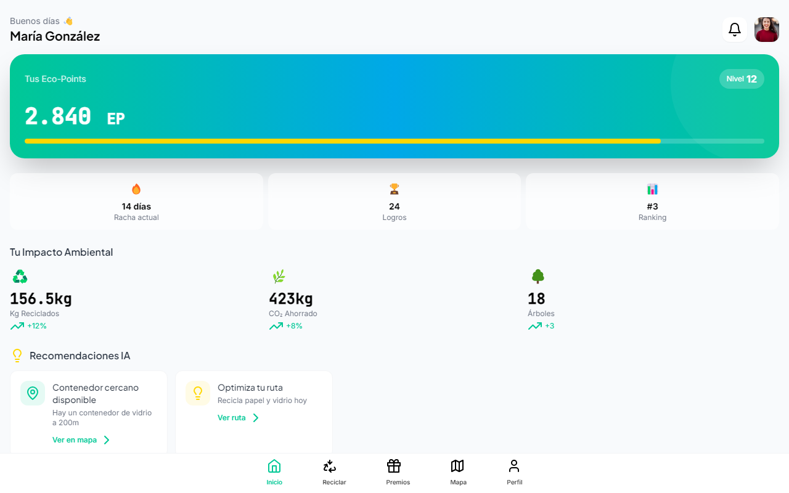

# 🌱 Verde Marga Marga · Web

[](https://github.com/Fernandamv96/verde-marga-marga-web/actions/workflows/ci.yml)
[](LICENSE)

Prototipo web de **Verde Marga Marga**, una plataforma de reciclaje con **eco-puntos**: impacto ambiental del usuario, tipos de reciclaje, marketplace de premios y recomendaciones. Los datos son simulados.

> Versión móvil: [-verde-marga-marga-mobile](https://github.com/Fernandamv96/-verde-marga-marga-mobile)



## ¿Qué problema resuelve?

Motiva el reciclaje en la provincia de Marga Marga premiando a quienes reciclan con puntos canjeables y mostrando su impacto (kg reciclados, CO₂ ahorrado y árboles equivalentes).

## Stack

HTML de un solo archivo con React 18 y Babel desde CDN, más Tailwind CSS (CDN). Sin build.

## Cómo correrlo localmente

```bash
npm ci && npm start     # http://localhost:8000
npm run lint            # html-validate
```

## 🔒 Calidad y seguridad

- CI en cada push y PR: `html-validate`, además de CodeQL, Dependabot y gitleaks en pre-commit.
- Para reportar vulnerabilidades, mira [SECURITY.md](SECURITY.md).

## 💡 Qué aprendí

- A prototipar una app completa en un solo HTML para validar la idea rápido.
- A revisar el código generado con herramientas de IA: la versión anterior traía un widget publicitario inyectado ("Created by MiniMax Agent") que abría enlaces externos sin `noopener`, y se eliminó.

## 📄 Licencia

[MIT](LICENSE) © 2026 Fernanda (Fernandamv96)
